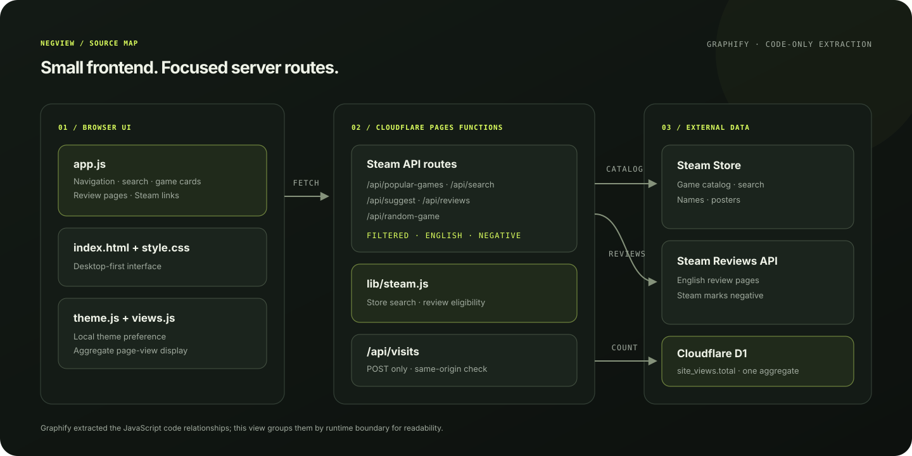

# NegView

**A Steam review browser for the other side of the review.** Browse games, search by title, and read English-language reviews marked negative by Steam. NegView is a noncommercial, desktop-first class project.

| Open | Link |
| --- | --- |
| **Live app** | [negview.pages.dev](https://negview.pages.dev/) |
| **GitHub Pages preview** | [sathvik071404.github.io/NegView](https://sathvik071404.github.io/NegView/) |
| **Source repository** | [Sathvik071404/NegView](https://github.com/Sathvik071404/NegView) |

The live app runs on Cloudflare Pages so its `/api/*` routes can call Steam. The GitHub Pages site is a static showcase that embeds the live app; GitHub Pages alone cannot run Cloudflare Pages Functions. Both the source repository and the GitHub Pages preview are public.

## What you can do

- Browse Steam’s current popular games in 15-game pages on a 5-by-3 desktop grid.
- Search Steam’s catalog with live suggestions and paginated results.
- Read English negative reviews, with Steam links for the game and author.
- Pick a random game that has at least one written English negative review.
- Switch between dark and light themes; the selected theme is stored locally.
- Use same-tab navigation, back-to-top, privacy and terms pages, and the custom 404 page.
- Share pages with branded social previews, and install the site from a compatible browser using its web app manifest.

## Project map

The graph below was generated from the source with Graphify. It shows the main code and API relationships.



## Run locally

NegView uses plain HTML, CSS, and JavaScript with Cloudflare Pages Functions. Opening `index.html` with `file://` only previews the static layout; search, reviews, random selection, and the visit counter need Wrangler.

```powershell
npx --yes wrangler pages dev .
```

Open the local URL printed by Wrangler. The D1 binding and local migration are defined in `wrangler.toml` and `migrations/`.

## Deploy

Cloudflare Pages is the application host. Connect this repository with production branch `main`, root directory `.`, no framework preset, and build output directory `.`. The `functions/api/` files map to `/api/*` routes.

The GitHub Pages deployment uses the `docs/` folder on `main`. It provides a public preview wrapper that embeds the Cloudflare-hosted app and links to it directly.

## API routes

| Route | Purpose |
| --- | --- |
| `/api/popular-games` | Paged current Steam popular games, filtered for English written negative reviews |
| `/api/search` | Paged Steam Store search with the same eligibility filter |
| `/api/suggest` | Live game title suggestions |
| `/api/reviews` | Paged English negative reviews for a Steam app ID |
| `/api/random-game` | A random Steam game with at least one written English negative review |
| `/api/visits` | Counts every page load in one aggregate Cloudflare D1 total |

The Steam Store search route is public but undocumented, so Steam may change it. Steam provides game details, art, and reviews; their owners retain those rights.

## Privacy

The footer count is **page views, not unique viewers**: refreshes and repeat visits add to the total. NegView stores only that aggregate integer for the counter. It does not use counter cookies or visitor IDs, or persist IP addresses, searches, or reviews. The theme choice stays in browser local storage. Cloudflare and Steam may process technical request information under their own policies; see [Privacy](privacy.html).

## Main files

- `index.html`, `style.css`, `app.js`, `theme.js` — interface and client-side navigation.
- `functions/api/`, `lib/steam.js` — Steam proxy routes and shared game eligibility checks.
- `functions/api/visits.js`, `views.js`, `migrations/` — aggregate page-view counter.
- `privacy.html`, `terms.html`, `404.html` — site information pages.
- `docs/` — GitHub Pages showcase.
- `robots.txt`, `sitemap.xml`, `llms.txt`, `.well-known/security.txt` — crawler guidance, public page discovery, site summary, and security contact.
- `_headers`, `manifest.json`, `favicon.svg`, `apple-touch-icon.svg`, `og-image.svg` — Cloudflare response policy, install metadata, and site artwork.
- `PLAN.md`, `NEXT_STEPS.md` — product scope and recommendations.
- `wrangler.toml` — Cloudflare Pages and D1 settings.

## License

Original NegView source code is licensed under the MIT License; see [LICENSE](LICENSE). Steam game names, reviews, images, and trademarks are not covered by that license.
